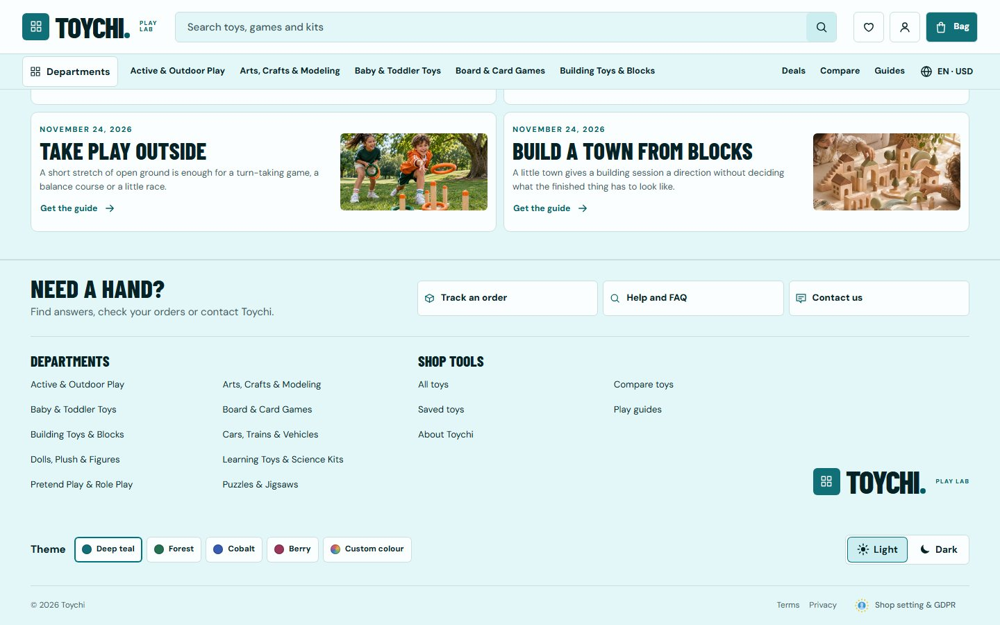
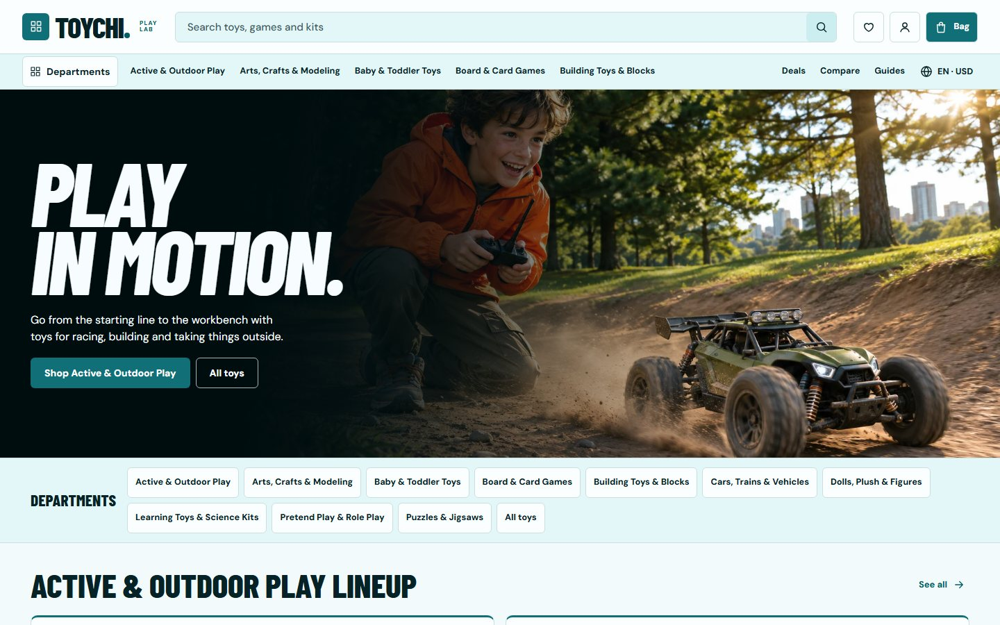
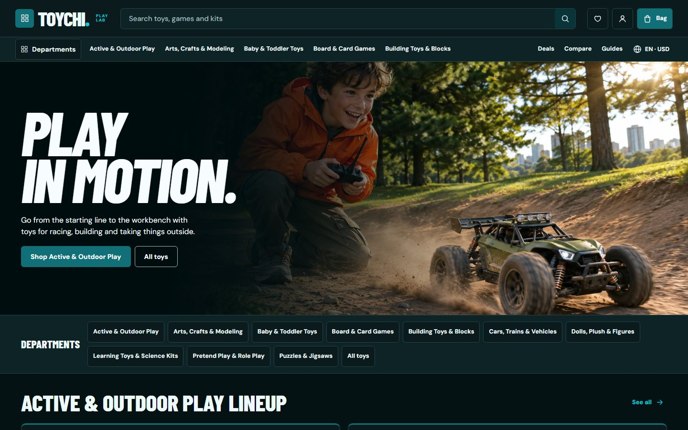
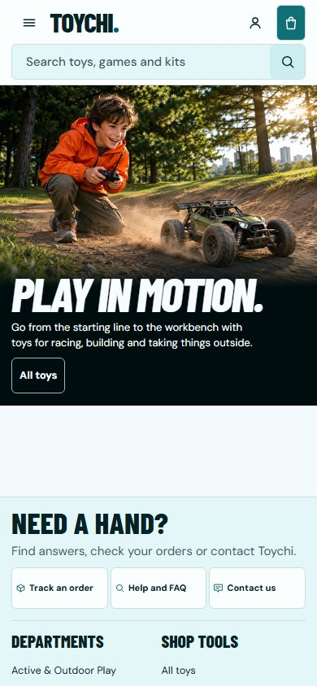
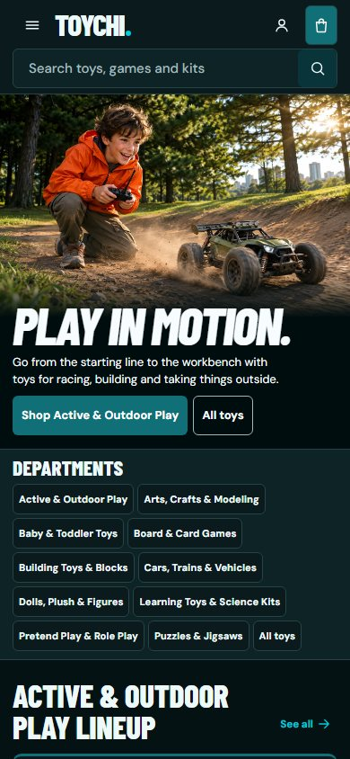

# Theme and colours

Playlab runs the **shared theme switcher** (`components/theme-switcher/`), the same code as the other custom Layouts. Playlab's palettes are in `components/ly/ly-theme.ts`, the **colour family** that paints every ground from the palette in `components/ly/ly-family.ts`, and the brand palette's values for the first paint (with the type and the shape scale) in `style/ly-skin.gen.scss`, all from the palettes of `skins/playlab/skin.json`; the **one file a merchant edits** is `components/ly/ly-theme.settings.ts`.

## One colour family

Playlab is drawn in one colour family: every colour on the page comes from the palette's hue, plus white and the family's near-black. Switching the palette, or picking a custom colour, re-tints the bands, the plates, the lines, the words, the dark top bar and footer, the chips, the map pin and the buttons at once; the browser's own theme colour follows the top bar.

`ly-family.ts` builds the family from the palette's colour in OKLCH, keeping its hue and capping its chroma, at fixed lightnesses:

| Part | Light mode | Dark mode |
| --- | --- | --- |
| Page | white | L .17 |
| Bands, soft tint | L .985 | L .195 |
| Cards | L .985, or white | L .225 |
| Plates under the pastries | L .966 | L .26 |
| Deeper tint (drawings, lines) | L .925 and .86 | L .31 |
| The dark top bar and footer | L .24 | L .15 |

Ink, muted words and field edges are then walked until they reach their contrast: ink 7:1 on the deeper tint, muted words 4.6:1, a field's edge 3:1; words on the dark bars use the hue at 7:1. The theme switcher writes only the action colour (`--ly-act`, `--ly-act-deep`, `--ly-act-on`, `--ly-act-text`) and Vuetify's primary on top, and `ly-family.ts` also repaints Vuetify's own dialogs, menus and fields from the same family.

## Playlab's colours

Playlab paints every action with **one colour**, Deep teal `#116f78` (white words 5.88:1) on every button, chosen state and link; on the dark top bar and footer the family's light shade (`--ly-act-dk`, `#65b7c0`) marks the hover. The Deep teal family is built from the seed `#116f78`.

Around it, in the light mode: a white page `#ffffff` with soft tint bands and cards `#f1fdfe`, plates `#e7f8fa`, a deeper tint `#c4f0f5`, near-black ink `#162426`, muted words `#516163`, lines `#cee5e8`; a dark top bar and footer in the family's darkest shade `#062427` with words `#ecfafc`. These are the Deep teal values: with another palette or a custom colour every one of them takes that colour's hue. In the dark mode, the family's night: the page and header `#091112`, bands and fields `#0d1718`, cards `#121e20`, plates `#11282b`, words `#e5f3f5`, muted words `#b0c2c4`, lines `#223133`, the top bar and footer `#000e10`, the action colour `#116f78` with white words and links `#6cbdc7`. Every colour is a token (`--ly-…`): `style/ly-skin.gen.scss` holds the brand palette's values (`:root` is light, `html.ly-dark` is dark) and `ly-family.ts` rewrites them for the palette on the page.

The mode from the settings file (light by default) is painted before the first paint on every shop, so the other mode never flashes.

## On Playlab's showcase shop



The **Theme** row sits in the footer, in a band of its own above the legal row, on the family's dark in both modes. It is never in the header. It holds:

- **Colour:** Deep teal, Forest, Cobalt, Berry (Deep teal is the default), and **Custom colour** (any colour from the browser's colour picker; the whole family is built from it and its action colour is made readable in light and dark against Playlab's own surfaces, with a note "Adjusted for readability" when it had to change).
- **Mode:** Light or Dark.

One click changes the whole site at once, with no reload: Playlab's colour family, the Kalio base, Vuetify's theme and Selldone's own parts (the buy button, prices, the bag drawer, the checkout sheets, dialogs). The choice is kept in the browser (key `playlab-theme`; dark mode is the class `pr-dark` on `<html>`) and painted before the first paint, so the default never flashes. The arrow keys (and Home / End) move between the swatches.

| Light (the default) | Dark |
| --- | --- |
|  |  |
|  |  |

## On your own shop

The visitor switcher is a **showcase** feature. With `themeSwitcher: "showcase"` it shows only on the Layout's own showcase shops (listed in `showcaseShops` in `components/ly/ly-theme.ts`; Playlab's is toychi, 16144). On any other shop it is not shown, nothing is read from or written to the browser's storage, and Playlab shows the theme from the settings file:

```ts
export const THEME_SETTINGS: ThemeSettings = {
  palette: "deep-teal",            // one of `deep-teal`, `forest`, `cobalt`, `berry`
  // brandColor: "#F5C400",  // any colour; replaces palette (the whole page takes its family)
  mode: "light",             // "light" | "dark"
  themeSwitcher: "showcase", // "showcase" | "on" (your visitors get it) | "off"
  textOnBrand: "auto",       // with brandColor: "auto" (a light brand keeps dark words) | "white"
};
```

| Setting | Allowed values |
| --- | --- |
| `palette` | `deep-teal`, `forest`, `cobalt`, `berry` (`deep-teal` is the brand and the default) |
| `brandColor` | any `"#RRGGBB"`; when set it replaces `palette`, and the whole page (bands, plates, lines, words, the dark bars) takes this colour's family |
| `mode` | `"light"` (white and the soft tint; the default) or `"dark"` (the family's night) |
| `themeSwitcher` | `"showcase"` (the visitor switcher shows only on the Layout's own showcase shops; the default), `"on"` (your visitors get the Theme row in the footer), `"off"` |
| `textOnBrand` | only with `brandColor`: `"auto"` (a light brand such as yellow keeps its colour, with dark words on it) or `"white"` (white words; a light colour is darkened) |

Every colour is made readable automatically: buttons, links, chosen states and dark mode.

## Examples

Change only these lines; leave the rest of the file as it is.

| You want | Set |
| --- | --- |
| "Use the rose theme" | `palette: "rose"` |
| "Use the yellow theme" | No palette is yellow, so use a brand colour: `brandColor: "#F5C400", textOnBrand: "auto"` |
| "My brand colour is #F5C400" | `brandColor: "#F5C400", textOnBrand: "auto"`; use `textOnBrand: "white"` for white words (the colour is then darkened) |
| "Make it dark" | `mode: "dark"` |
| "Let visitors switch themes" | `themeSwitcher: "on"` |
| "Remove the switcher" | `themeSwitcher: "off"` (on your own shop it is already hidden with `"showcase"`) |
| "Go back to the original colours" | remove `brandColor`, set `palette: "deep-teal", mode: "dark"` |

Then build and upload a new version and put it live:

```bash
LAYOUT_ID=<your Layout id> PW=<path>/node_modules/playwright/index.js SELLDONE_CLI_SRC=<cli clone> \
  bash scripts/release.sh <new version> desk
```

See [Build and Upload](Build-and-Upload) and [Go Live](Go-Live).

## Contrast

| Palette | Seed of the family | Light: action colour, white words on it | Light: link colour on the tint band / the plate | Dark: action colour, white words on it | Dark: link colour on the card |
| --- | --- | --- | --- | --- | --- |
| Deep teal | `#116f78` | `#116f78` 5.88:1 | 5.67:1 / 5.38:1 | `#116f78` 5.88:1 | `#6cbdc7` on `#121e20` 7.91:1 |
| Forest | `#237151` | `#237151` 5.91:1 | 5.69:1 / 5.40:1 | `#237151` 5.91:1 | `#76c19d` on `#141e19` 8.04:1 |
| Cobalt | `#365bb3` | `#365bb3` 6.36:1 | 6.09:1 / 5.76:1 | `#4268c2` 5.26:1 | `#8aafff` on `#181c24` 7.85:1 |
| Berry | `#9c355a` | `#9c355a` 6.84:1 | 6.53:1 / 6.15:1 | `#b1486b` 5.24:1 | `#fd8dae` on `#23181b` 7.88:1 |

Each figure is worked out from the colours `scripts/skin-apply.mjs` gives each palette (the same maths as `ly-family-core.ts`). A custom or brand colour goes through `paletteFromColor()`, which moves only its lightness until each role reads against the Layout's surfaces; its family is built from the same colour. The contrast audit must pass with `TOTAL 0` for every palette and for the custom colours `#ffff00`, `#00ffff` and `#111111`, in light and dark.

## Checks

Run these from the repository root after a theme change. They need Playwright; set `PW` to your install (`PW=<path>/node_modules/playwright`), because the default path in the scripts is not yours. `".pr .ftr"` is Playlab's footer, which every page shows once it is ready. Run one at a time: Selldone limits how many requests one address may send in a minute.

1. **Contrast** on the live shop, at desktop and phone width. It must print `TOTAL 0`:
   ```sh
   PAGES="home=/,category=/<a category>,product=/product/<id>" \
     node components/theme-switcher/tools/contrast-audit.cjs https://<your shop> ".pr .ftr"
   ```
   To test one palette and mode, add `STORAGE='{"playlab-theme":"{\"palette\":\"deep-teal\",\"mode\":\"dark\"}"}'` (this works where the switcher is shown).
2. **Bag drawer, bag page and address sheet.** It must print `TOTAL 0`. It fills a bag in the browser only and blocks every order request. The palette argument is a palette id, or `custom:#rrggbb` for a custom colour:
   ```sh
   SHOP=<your shop's xapi name> STORAGE_KEY=playlab-theme WAIT=".pr .ftr" CART=".bag-btn" \
     node components/theme-switcher/tools/cart-audit.cjs https://<your shop> deep-teal light
   ```
3. **Underlines, boxes and shapes.** No line under any word or icon (a post's own links aside), at rest or on hover; photos never on words, icon rows aligned; every edge a circle, 8 px or 4 px, focus keeping its shape, nothing past the window. Each must print `TOTAL 0`:
   ```sh
   PAGES="home=/,category=/<a category>,product=/product/<id>" node scripts/underline-check.cjs https://<your shop> ".pr .ftr"
   SHOP=<your shop's xapi name> PAGES="home=/,category=/<a category>,product=/product/<id>" \
     node scripts/box-check.cjs https://<your shop> ".pr .ftr"
   PAGES="home=/,category=/<a category>,product=/product/<id>" node scripts/shape-check.cjs https://<your shop> ".pr .ftr"
   ```
   All three default to the showcase shop's pages, so always pass `PAGES` (and `SHOP` for the box check, which also opens the menus, a quick view and the bag).
4. **Colour maths:** `node components/theme-switcher/theme-color.test.mjs` (Node 22.6 or newer).

On Playlab's showcase shop the same checks run with `https://playlab.selldone.shop` (or the dev server, `http://localhost:9177`), `SHOP=toychi-KX4iQgu0`, `PAGES="home=/,category=/croissants-category,product=/product/720375"`, for each palette in light and dark. `scripts/run-checks.sh <base> <log folder>` is the full set that produced 1.0.0's test table, one browser at a time; a few of its checks (the ring, corner and circle checks and one card-edge check) come from a shared check kit that is not part of this repository, so on your own copy run the checks above.
